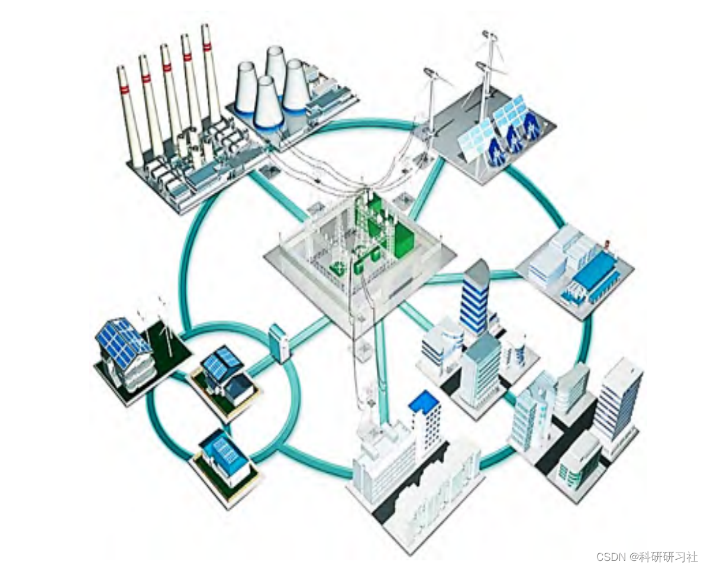
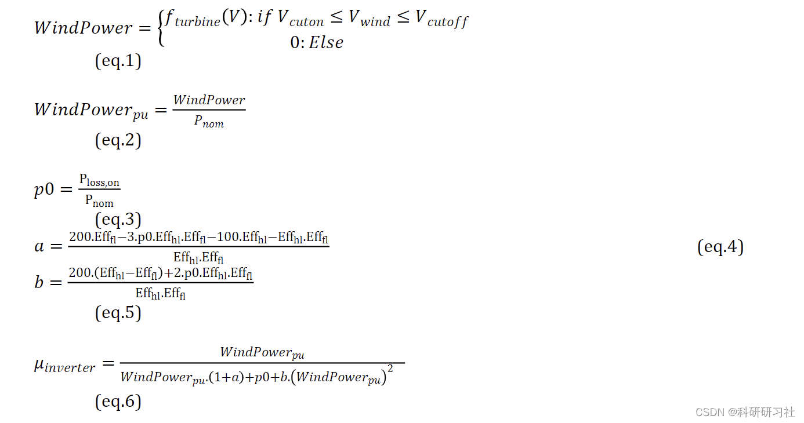
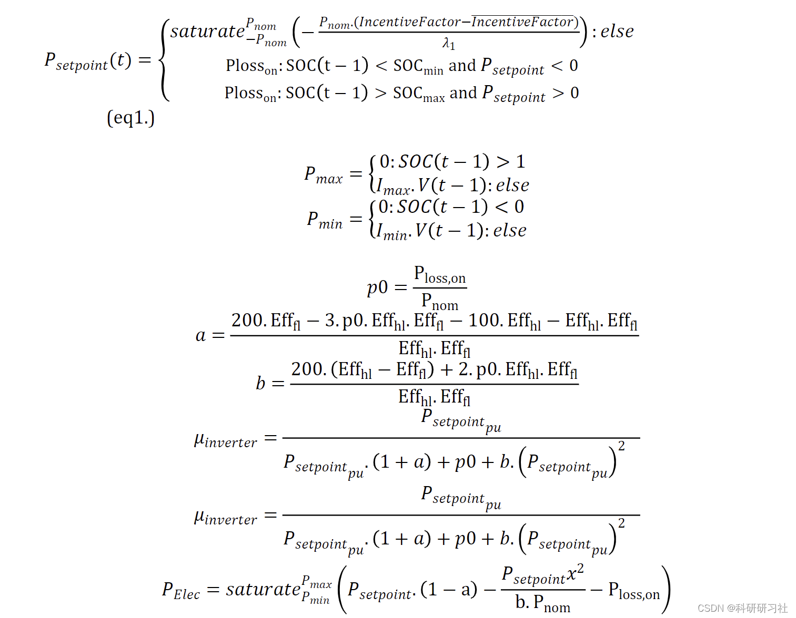
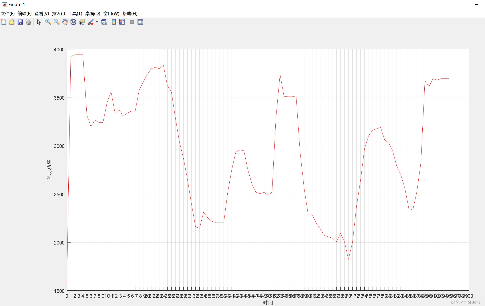
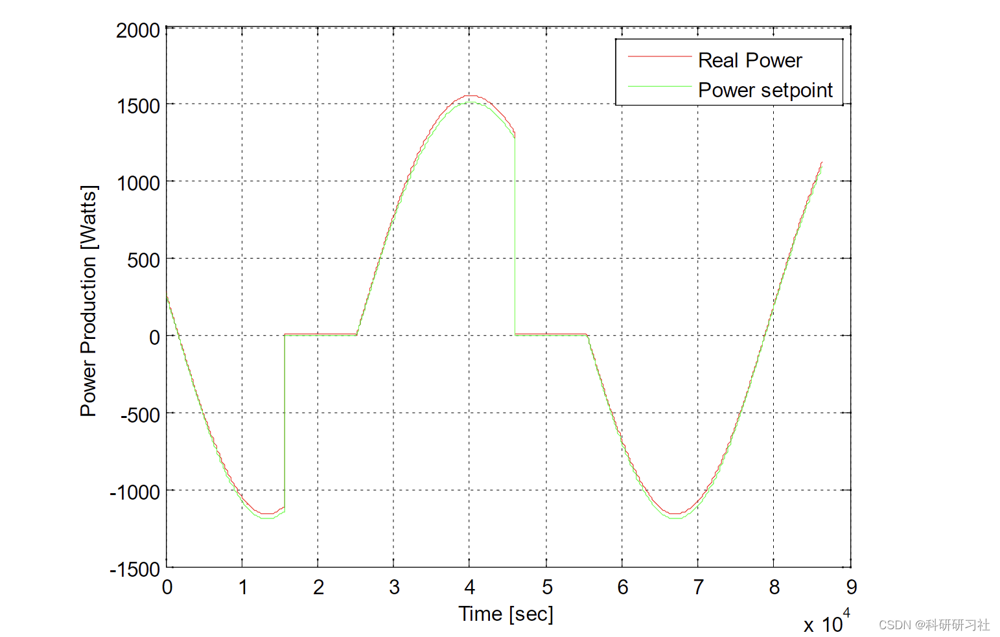
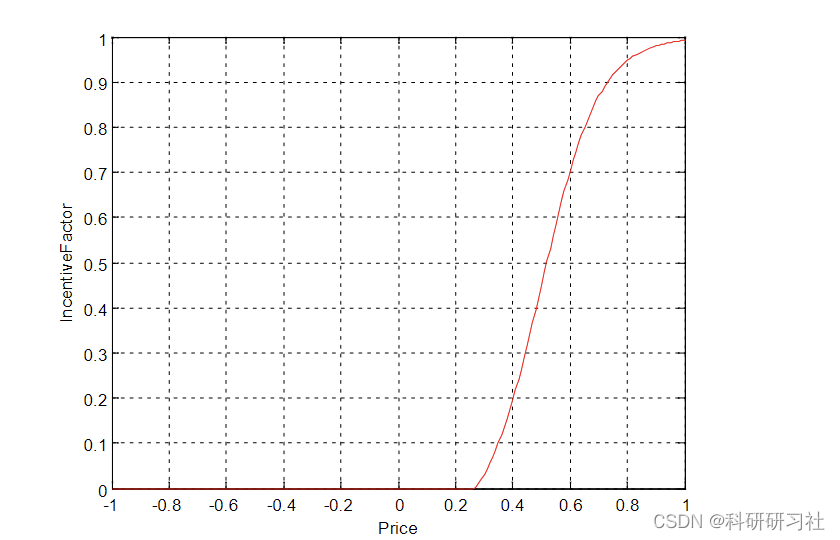
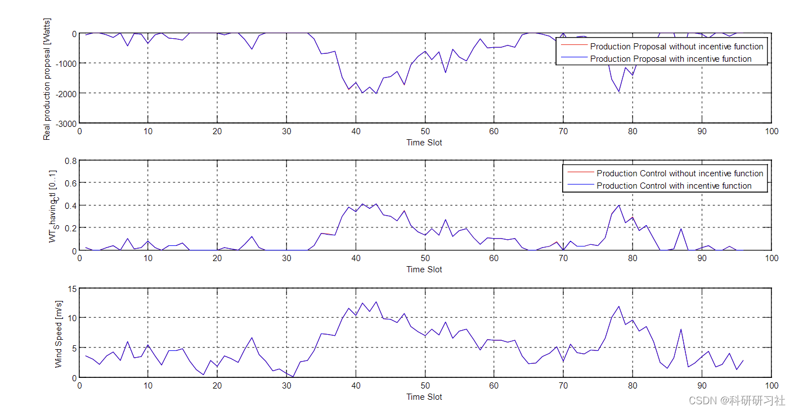
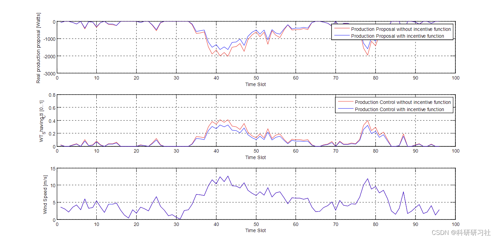

# Smart Grid Optimized Scheduling (Matlab Code Implementation)

​  
Contents
1. Overview
2. Comprehensive Analysis of Smart Grid
3 Mathematical Models
4 Running results
5 Matlab code and detailed article
6 References
7. Conclusion
Editor
1. Overview: In response to the ever-increasing demand for electrical resources, traditional power grids are struggling to meet this demand. In recent years, China has made significant progress in the construction of smart grids, but there are still some issues that inevitably arise during the process, severely limiting the further expansion of the scope of smart grid construction in China. The application of electromechanical engineering technology in the construction of smart grids can significantly improve the efficiency and quality of smart grid construction, which is of great significance for the sustainable development of the national power grid.
Therefore, it is necessary to delve into the in-depth application of electromechanical engineering in the construction of smart grids, providing a reliable basis for power grid development. On the basis of enhancing the quality of smart grid construction, it promotes an improvement in people's living standards and contributes to the advancement of socio-economic development.
Editor
Figure 1: Smart Grid Design Display
2. Comprehensive Analysis of Smart Grid
Currently, countries around the world are facing resource constraints, and the public's interest in power grid construction is growing daily. To effectively address a series of issues caused by the energy crisis, the United States first proposed the concept of smart grid construction, which has played an important role in promoting sustainable development in other industries. The main components of a smart grid can be divided into transmission systems and automation accessories. Relying on advanced measurement and sensing technologies as well as control technology, it provides assurance for the reliable operation of the power grid.
3. Mathematical Model Editing
Detailed mathematical models are available in Part 5.
Editor
4. Running Results Editing
Editor, editor, editor.
Editor
5. Matlab code and detailed article - this article only showcases a portion of the code, all code and articles can be found in:
Editor
6 References [1] Liu Lin. Exploring the Application of Mechanical and Electrical Engineering Technology in the Construction of Smart Grids [J]. Science Information, 2022, 20(03): 37-39. DOI: 10.16661/j.cnki.1672-3791.2112-5042-3330.
[2] Tang He, Chen Jinrong. Research on Adaptive Control of Smart Grid Scheduling Considering Line Operation State [J]. Power Grid and Clean Energy, 2022, 38(01): 82-88.
7 End Note

## Images

<!-- PAYMENT_BLOCK -->

## Get this dataset

- Payment link (Stripe): [Buy now](https://buy.stripe.com/3cs8yP7sY87d0vu9AB)
- Payment QR code: 

<!-- /PAYMENT_BLOCK -->
